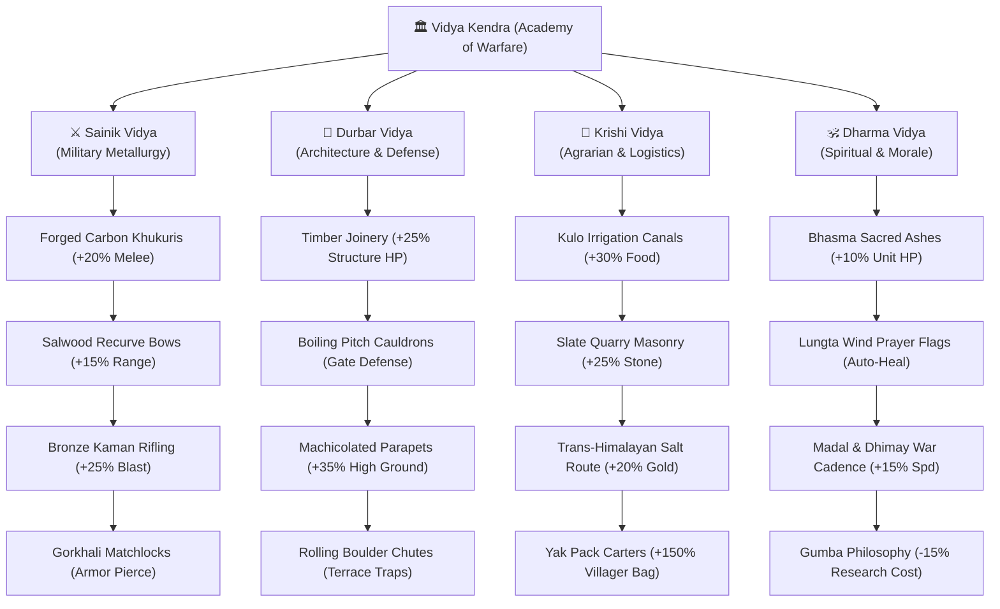
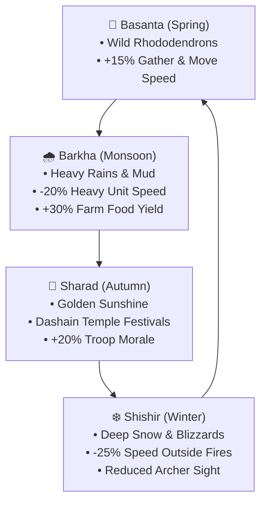
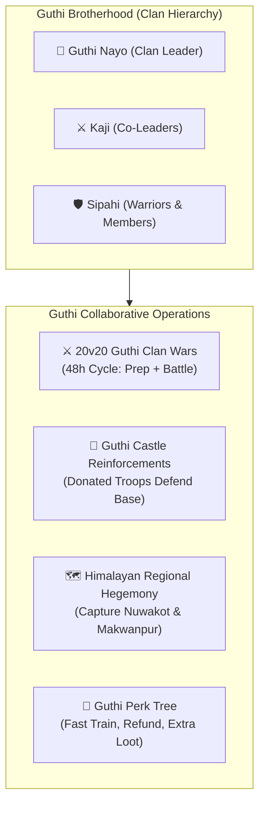

# 📋 Gorkha: Rise of the Kingdom — Feature Roadmap & Task Backlog
## Aligning with Clash of Clans (CoC) & Age of Empires (AoE) Mechanics

**Document Version:** 1.0  
**Target Platforms:** Unity 3D Client (`unity-client/`) & Flutter/Flame Client (`game-client/`)  
**Design Philosophy:** Combine the intuitive base-building, tactile harvesting, and defensive base-layout strategy of **Clash of Clans** with the deep historical era progression, villager resource harvesting, RTS unit formations, and tactical counter-combat of **Age of Empires**.

---

## 🧭 Milestone Overview


---

## 🎨 Phase 0: Graphics & Professional User Experience (UX/UI Polish)

| Task ID | Feature Title | Inspiration | Priority | Status |
| :--- | :--- | :--- | :--- | :--- |
| **GFX-01** | **URP Himalayan Lighting & Atmospheric Mist** | Studio Standard | **P0** | ✅ Completed |
| **GFX-02** | **Ground Terrain Shading, Cobblestone Walkways & Foliage** | AoE / CoC | **P0** | ✅ Completed |
| **GFX-03** | **Dynamic Particle Systems (Chimney Smoke, Torches, Dust Puffs)** | CoC | **P0** | ✅ Completed |
| **GFX-04** | **Procedural Himalayan Soundscape (Mountain Wind & Melodic Chimes)** | AoE | **P1** | ✅ Completed |
| **GFX-05** | **Fantasy Kingdom Unity 6 3D Asset Integration (Modular Buildings & SpeedTree Pines)** | Unity 6 / Synty | **P0** | ✅ Completed |
| **GFX-06** | **Bloom Glare Clamp & Lighting Shading Calibration (No Glare, 3D Medallions)** | Studio Standard | **P0** | ✅ Completed |
| **GFX-07** | **Himalayan Army Archetypes & Stylized Weapons (Khukuris, Spears, Bows, Shields)** | Synty / AoE | **P0** | ✅ Completed |
| **GFX-08** | **Kinetic Machinery & Armory Outpost Dressing (Spinning Windmill & Armory Props)** | Synty / CoC | **P0** | ✅ Completed |
| **GFX-09** | **Fantasy Kingdom Environment Parity (Tiled Ground, Lake, Grass, Walls, SSAO, VFX)** | Fantasy Kingdom | **P0** | ✅ Completed |
| **GFX-10** | **Articulated Procedural Skeletal Animations (Walk Cycles, Weapon Strikes, Flinch)** | AoE / Synty | **P0** | ✅ Completed |
| **GFX-11** | **Parabolic Ballistic Projectiles (Gravitational Flight & Sticking Arrow Impact)** | AoE / CoC | **P0** | ✅ Completed |
| **GFX-12** | **Synty POLYGON Humanoid 3D Character Models (`SM_Chr_Male_01` / `Female_01`)** | Synty Studios | **P0** | ✅ Completed |
| **UX-01** | **Clash of Clans Studio HUD Redesign (Resource Bars & Dock)** | CoC | **P0** | ✅ Completed |
| **UX-02** | **Tactile 3D Building Selection Ring & Bounce Hop** | CoC | **P0** | ✅ Completed |
| **UX-03** | **Signature CoC Harvest Bubbles & Floating Popups** | CoC | **P0** | ✅ Completed |
| **UX-04** | **Precision 3D Building Placement Grid & Snap Audio** | CoC / AoE | **P0** | ✅ Completed |
| **UX-05** | **Cinematic RTS Camera Inertia & Edge Panning** | AoE | **P1** | ✅ Completed |
| **UX-06** | **World-Space Dynamic Combat Health Bars (Billboarded Gradient & Auto-Fade)** | CoC / AoE | **P0** | ✅ Completed |

### Detailed Specifications (Phase 0)

#### GFX-01: URP Himalayan Lighting & Atmospheric Mist
- Golden-hour directional sun (`#FFF4E6`, 1.35x intensity) cast at $50^\circ$ elevation for long dramatic shadows.
- Multi-tier trilight ambient lighting: Alpine Sky Blue overhead, warm earth terraced midpoint, and rich forest shadow ground.
- Realistic distance fog (`FogMode.ExponentialSquared`) softly blending distant Himalayan peaks into the sky.

#### GFX-02: Ground Terrain Shading, Cobblestone Walkways & Foliage
- Tiled alpine grass with subtle per-tile variations and stone edge trims.
- Procedural cobblestone pathways radiating from Gorkha Durbar to outward workshops and military camps.
- Perimeter alpine pine trees with layered branches and mountain slate boulders.

#### GFX-03: Dynamic Particle Systems
- Gently curling chimney smoke rising from Town Center, cottage huts, and barracks forge.
- Warm flickering torch flames on Kot barracks gateposts and Watchtower corners.
- Ground dust puff effect triggering when placing buildings or completing construction.

#### GFX-04: Procedural Himalayan Soundscape
- Dynamic audio synthesizer enhancements: tactile wooden UI clicks, harp arpeggio harvest chimes, deep stone building thuds, and victory fanfare.
- Ambient mountain breeze loop with subtle temple bell resonance.

#### GFX-05: Fantasy Kingdom Unity 6 3D Asset Integration
- Seamless binding of Unity 6 Fantasy Kingdom modular 3D prefabs via `FantasyKingdomAssetRegistry`:
  - **Town Center (Durbar):** `Preset_Church_01_A.prefab` (grand stone foundation & soaring timber keep).
  - **Barracks (Kot):** `Preset_Blacksmith_01.prefab` (fortified armory with outdoor training compound).
  - **Farm (Krishi Kshetra):** `Preset_House_Windmill_01.prefab` (wind-driven mill with stone base).
  - **Woodcutter Camp:** `Preset_Shelter_02.prefab` (timber logging shelter).
  - **Stone Quarry:** `Preset_Hut_01.prefab` (stone masons' hut).
  - **Residential Cottages:** `Preset_House_01_A.prefab` (multi-tier Newari/medieval cottage).
  - **Watchtower (Suraksha Minar):** `Preset_Tower_01.prefab` (high defensive stone bastion).
  - **Perimeter & Harvest Scenery:** SpeedTree 9 wind-animated pine trees (`TreePine_VarA/B/C.prefab`) and granite boulders (`Rocks_01/11.prefab`).
- Exact mathematical bounding offsets and proportional RTS scaling so all models sit perfectly grounded on 2x2 grid footprints without floating or misalignment.
- Automatic procedural mesh generation fallback (`Nepali3DMeshBuilder`) whenever a prefab is unassigned.

#### GFX-06: Bloom Glare Clamp & Lighting Shading Calibration
- Clamped URP Bloom maximum threshold to $1.25$ (previously unclamped at $65472$) with softened golden-hour tint in `SampleSceneProfile.asset`, eliminating the blinding white glare over the Town Hall.
- Reduced Directional Sun intensity from $2.0$ down to natural Himalayan mountain ambient $1.15$ with softened shadow bias.
- Updated Royal Red Flag material (`GorkhaMaterials.RoyalRedFlag`) with double-sided rendering (`_Cull 0`) and vibrant crimson non-specular diffuse, fixing the shadowed black backface silhouette bug.
- Upgraded harvest floating bubbles from raw tilted yellow cubes to 3D golden coin medallions (`Nepali3DMeshBuilder.BuildHarvestMedallion`) with rim-glow and smooth collection popping animation.

#### GFX-07: Himalayan Army Archetypes & Stylized Weapons
- Multi-class 3D character generator (`Nepali3DMeshBuilder.BuildUnit`) matching Synty low-poly proportions:
  - **Khukuri Warrior:** Daura Suruwal tunic, Patuka crimson sash, Dhaka Topi with golden crest, curved steel Khukuri with Kauda cho notch, and round wooden buckler shield with brass rim and iron center boss.
  - **Gorkha Spearman:** Conical iron combat helmet with golden spire, 2.3m Salwood spear with steel leaf head and crimson pennant, and heavy infantry rectangular pavise tower shield with royal sun crest.
  - **Mountain Archer:** Scout headband with crimson feather plume, carved horn/wood reflex recurve bow, and leather back quiver containing 3 fletched arrows.
  - **Civilian Villager:** Woven bamboo straw sun hat, double-bitted lumber axe / mining pickaxe, and dynamic resource sack that visibly straps to the villager's back when harvesting timber or slate and disappears upon drop-off.
  - **Hostile Raider Bandit:** Slate-iron war vest, crimson war bandana with spikes, and dual-wielded raiding blades.

#### GFX-08: Kinetic Machinery & Armory Outpost Dressing
- **Kinetic Windmill Sails (`SmoothRotator`):** Continuous frame-rate independent rotation (28 deg/sec around local Z axis) operating seamlessly in both Edit Mode and Play Mode, mounted precisely at the hub axle of `Preset_House_Windmill_01`.
- **Kot Barracks Armory Yard:** Dressed with heavy forged blacksmith anvil on tree stump block, A-frame wooden weapon racks displaying upright spears, and straw concentric archery targets with stuck practice arrows.
- **Outpost Supply Stacks:** Timber cargo crates and iron-banded storage barrels clustered outside logging camps, stone quarries, farms, and Town Center command posts.

#### GFX-09: Fantasy Kingdom Environment Parity
- **Textured Tiled Alpine Ground:** Replaced flat single-color boxes with a high-resolution 16x16 tiled terrain mesh utilizing `Atlas_Ground_Rocks.mat` (`Atlas_Ground_Base_Color.png` & `Atlas_Ground_Normal.png`), rendering sharp pebbles, grass tufts, and mountain loam.
- **Living Alpine Lake & Stream:** Scenic western water plane (`WaterLake.mat`) with animated depth wave displacement, sun glints, depth foam shorelines, submerged lakebed, and shoreline granite boulders.
- **Waving Meadow Grass Scatter:** Clustered `Scatter_Grass` prefabs with vertex wind sway (`Atlas_Foliage`) lining the road shoulders, boulders, and perimeter.
- **Fortified Town Wall Perimeter:** Modular stone fortress battlements (`SM_Town_Wall_Border_01`), corner bastion watchtowers (`SM_Town_Wall_Border_04`), and fortified stone gatehouse archways (`SM_Town_Wall_Border_10`) enclosing the kingdom.
- **Desktop Volume Profile & SSAO Contact Shadows:** Upgraded active scenes to `Global Volume Profile Desktop.asset` with Screen Space Ambient Occlusion (SSAO) eliminating floating artifacts, ACES Tonemapping, Color Adjustments, White Balance, and Vignette.
- **Living Himalayan Atmospheric VFX (`HimalayanAtmosphericVFX`):** Integrated Visual Effect Graph systems for curling chimney smoke plumes, windblown autumn leaves tumbling through village streets, sunlit pollen dust motes, and soaring eagle/crow flocks.

#### UX-01: Clash of Clans Studio HUD Redesign
- Custom high-contrast slate cards with golden filigree borders for top resource trackers (Food, Wood, Stone, Gold, Gems).
- Resource capacity progress bars and live production rate badges (+/sec).
- Bottom construction dock featuring categorized building blueprint cards with cost indicators and hover glow.

#### UX-02: Tactile 3D Building Selection Ring & Bounce Hop
- Animated glowing selection baseplate/ring on ground beneath active building.
- Spring-physics "bounce hop" when clicking buildings or harvesting.
- Quick action radial/context dock: Upgrade, Info, Collect, Close.

#### UX-03: Signature CoC Harvest Bubbles & Floating Popups
- 3D floating orb floating above resource buildings (coin, sheaf, timber, ore).
- One-click tap with spring-pop collection animation and rising gold floating text.

#### UX-04: Precision 3D Building Placement Grid & Snap Audio
- Real-time grid projector under cursor showing emerald-green footprint for valid placement, ruby-red for blocked tiles.
- Grid-cell audio snapping sound as player sweeps blueprint across the terrain.

#### UX-05: Cinematic RTS Camera Inertia & Edge Panning
- Smooth damping inertia for keyboard WASD and mouse-drag panning.
- Optional RTS edge panning (moving mouse to viewport boundary pans the view).
- Smooth exponential zoom and double-click building focus.

#### GFX-10: Articulated Procedural Skeletal Animations
- Articulated joint hierarchy (`HipLeft`, `HipRight`, `ShoulderLeft`, `ShoulderRight`, `Torso`, `Head`) driven by `UnitProceduralAnimator`.
- Opposing harmonic hip walk cycles ($\pm 32^\circ$) and counter-phase shoulder swings ($\pm 24^\circ$) matching real human locomotion.
- True weapon combat routines:
  - **Khukuri Warrior:** High windup raise, downward cross slash across chest, and recovery.
  - **Spearman:** Rear-foot plant and two-handed forward spear lunge ($0.45\text{ m}$ forward drive).
  - **Mountain Archer:** Left-arm bow elevation, right-hand bowstring draw to cheek, and snap release with bow vibration recoil.
  - **Villager:** Overhead two-handed axe/pickaxe power chop rhythmically striking trees and stone boulders.
  - **Hit Flinch:** Knockback torso and head recoil with quick recovery.

#### GFX-11: Parabolic Ballistic Projectiles
- True gravitational parabolic flight paths (`BallisticProjectile`) for physical arrows fired by Watchtowers and Archers.
- Real-time orientation matching trajectory velocity vector $\vec{v}(t)$ with dynamic target leading.
- Sticking impact realism: arrows stick directly into targeted units or buildings upon impact for 2.8 seconds.

#### UX-06: World-Space Dynamic Combat Health Bars
- Camera-billboarded, high-contrast slate-bordered health bars (`WorldCombatHealthBar`) hovering above damaged units ($1.85\text{ m}$) and buildings ($3.2\text{ m}$ / $4.8\text{ m}$).
- Smooth color gradient transition: Emerald Green ($>55\%$) $\to$ Golden Amber ($55\% - 25\%$) $\to$ Ruby Crimson ($<25\%$).
- Auto-hides when units/buildings are at full health during peace, appearing instantly upon taking damage and fading after combat resolves.

#### GFX-12: Synty POLYGON Humanoid 3D Character Integration
- Replaced blocky procedural character models with Synty Studios **POLYGON - Starter Pack** rigged humanoid 3D character meshes (`SM_Chr_Male_01` and `SM_Chr_Female_01`).
- Dynamically rigged and accessorized with authentic historic Nepali gear via `Nepali3DMeshBuilder`:
  - **Khukuri Warrior (*Asal Sipahi*):** Traditional geometric Dhaka Topi with golden sun crest, curved steel Khukuri blade in right hand, round brass-rim buckler shield on left arm.
  - **Gorkha Spearman (*Bhaledar*):** Conical iron combat helmet with golden Gajur spire, 2.3m Salwood spear with royal red pennant in right hand, heavy infantry rectangular pavise shield on left arm.
  - **Mountain Archer (*Dhanurdhari*):** Scout headband with crimson feather plume, carved horn/wood reflex recurve bow in left hand, back leather quiver with fletched arrows.
  - **Civilian Villager:** Woven bamboo straw sun hat (*Ghum*), lumberjack axe / mining pickaxe, dynamic carried resource back-sack.
  - **Hostile Bandit Raider:** Spiked bandit war bandana, dark slate iron palette (`PolygonStarter_03.mat`), dual blades.
- Sockets weapons directly into hand bones (`Hand_R`, `Hand_L`), headwear onto `Head`, and quivers/sacks onto `Spine_02`.
- Hair mesh (`Character_Hair_Male_01` / `Female_01`) dynamically hidden when wearing enclosed helmets or hats to prevent clipping.
- Procedural animator (`UnitProceduralAnimator`) upgraded to automatically bind Synty bone hierarchies (`UpperLeg_L/R`, `Shoulder_L/R`, `Hips`, `Head`) and multiply relative rotations onto rest poses, supporting both Synty humanoid and procedural rigs.
- Auto-upgrades existing units in scenes upon launch via `UnitController.EnsureVisuals()`.

---

## 🌾 Phase 1: Economy, Villager Work & Base Management (CoC + AoE)

| Task ID | Feature Title | Inspiration | Priority | Status |
| :--- | :--- | :--- | :--- | :--- |
| **ECO-01** | **Resource Storage & Capacity Cap System** | CoC | **P0** | ✅ Completed |
| **ECO-02** | **Villager Work Loop (Tree Chopping & Stone Mining)** | AoE | **P0** | ✅ Completed |
| **ECO-03** | **Builder / Craftsman Management (Dakshya Karmi)** | CoC | **P1** | ✅ Completed |
| **ECO-04** | **Building Relocation & Smooth Drag-to-Move** | CoC | **P1** | ✅ Completed |
| **ECO-05** | **Mini-Map Navigation & Radar View** | AoE | **P1** | ✅ Completed |

### Detailed Specifications

#### ECO-01: Resource Storage & Capacity Cap System (CoC)
- **Concept:** Differentiate between **Production Collectors** (Farms, Lumber Camps, Quarries) and **Primary Storages** (Granary for Food, Treasury/Vault for Gold, Timber Yard for Wood, Slate Depot for Stone).
- **Gameplay Mechanics:**
  - Resource buildings slowly accumulate uncollected yields up to their internal buffer.
  - Clicking the floating 3D bubble or building transfers resources into the kingdom's primary storages.
  - Primary storages have capacity caps that can be increased by upgrading them.
  - Visual gauge on storage buildings showing 0%, 25%, 50%, 75%, 100% fill levels.

#### ECO-02: Villager Work Loop (Tree Chopping, Stone Mining, Farming) (AoE)
- **Concept:** Bring the settlement to life with functional civilian villagers (*Kisan* & *Karmi*) who physically gather resources.
- **Gameplay Mechanics:**
  - Clicking a tree orders an idle villager to chop it with an axe, carrying wood bundles back to the nearest Lumber Camp or Town Center.
  - Clicking a mountain slate boulder orders a villager to mine stone with a pickaxe.
  - Villagers working on terraced farms cultivate and harvest wheat sheaves.
  - Trees and boulders slowly deplete and disappear, allowing players to clear the forest to expand their village layout (just like AoE & CoC obstacles).

#### ECO-03: Builder / Craftsman Queue (Dakshya Karmi) (CoC)
- **Concept:** Limit simultaneous construction and upgrades by the number of active master builders.
- **Gameplay Mechanics:**
  - Start with 2 Builder Huts (*Karmi Chhauni*), upgradable/purchasable up to 5 with Gems.
  - When an upgrade or construction begins, an animated builder walks to the site and works with scaffolding.
  - If all builders are busy, construction queue warns: *"All builders are busy!"* with option to free one using Gems.

#### ECO-04: Building Relocation & Edit Mode (CoC)
- **Concept:** Allow players to reorganize their settlement layout without demolishing buildings.
- **Gameplay Mechanics:**
  - Press-and-hold or click "Move" on any building to lift it.
  - Shows green/red footprint preview as it drags across the 3D grid.
  - Releasing places the building in the new valid location.
  - Dedicated "Layout Editor" mode allowing one-click clearing and restructuring of village walls and defenses.

#### ECO-05: Mini-Map with Live Radar (AoE)
- **Concept:** Corner overview map displaying terrain boundaries, friendly buildings, units, and resource deposits.
- **Gameplay Mechanics:**
  - Renders 2D top-down isometric diamond projection of the 24x24 / 48x48 world.
  - Color-coded blips: Blue (Town Center/Buildings), Yellow (Resource Collectors), Green (Friendly Units), Red (Hostile Patrols).
  - White rectangle shows current camera viewport.
  - Clicking any point on the mini-map smoothly pans the camera there instantly.

---

## 🏰 Phase 2: Fortifications, Defenses & Base Layout Strategy (CoC Style)

| Task ID | Feature Title | Inspiration | Priority | Status |
| :--- | :--- | :--- | :--- | :--- |
| **DEF-01** | **Placeable & Connectable Fortification Walls** | CoC / AoE | **P0** | ✅ Completed |
| **DEF-02** | **Archer Watchtowers with Auto-Targeting Radius** | CoC / AoE | **P0** | ✅ Completed |
| **DEF-03** | **Kaman (Mountain Cannon) Heavy Defense** | CoC | **P1** | ✅ Completed |
| **DEF-04** | **Himalayan Concealed Traps (Pit Traps & Rolling Logs)** | CoC | **P1** | ✅ Completed |
| **DEF-05** | **Settlement Shield & Peace Treaty Timer** | CoC | **P2** | ✅ Completed |

### Detailed Specifications

#### DEF-01: Placeable & Connectable Fortification Walls (CoC / AoE)
- **Concept:** 1x1 tile stone and timber walls that dynamically connect to adjacent wall segments.
- **Gameplay Mechanics:**
  - Players drag lines of walls to enclose their Gorkha Durbar and resource storages.
  - Automatic corner posts, straight connectors, and T-junctions.
  - Level progression:
    - **Lv 1:** Bamboo & Sal Wood Stakes (*Kandeghari*)
    - **Lv 2:** Clay & Terracotta Brick Ramparts (*Mato Killa*)
    - **Lv 3:** Dressed Himalayan Slate Stone Wall (*Dhungo Killa*)
    - **Lv 4:** Iron-Reinforced Fortress Bastions with crenellations.
  - Wall Gates (*Dhoka*) allowing friendly units to pass through while keeping enemies out.

#### DEF-02: Archer Watchtowers with Auto-Targeting Radius (CoC / AoE)
- **Concept:** Defensive towers with garrisons that attack hostile units entering their perimeter.
- **Gameplay Mechanics:**
  - Selecting a tower reveals a translucent circular range radius (e.g. 10 meters).
  - 3D archer stationed on top aims and fires animated physical arrows with parabolic arcs at the closest enemy unit.
  - High ground advantage: Towers placed on mountain ridges gain +15% range and damage bonus.

#### DEF-03: Kaman (Himalayan Mountain Cannon) Heavy Defense (CoC Mortar Style)
- **Concept:** Long-range, slow-firing heavy mortar battery based on historical Gorkhali bronze cannons.
- **Gameplay Mechanics:**
  - Has a minimum blind-spot radius (2m) and long maximum range (16m).
  - Fires explosive cannonballs with splash damage that knock down clusters of light infantry.
  - Deep percussive cannon blast audio with smoke particle effects.

#### DEF-04: Himalayan Concealed Traps (CoC Spring Trap Style)
- **Concept:** Hidden traps placed in pathways between walls that trigger when enemy troops walk over them.
- **Gameplay Mechanics:**
  - Invisible to enemy players in battle view; visible to defending player in village view.
  - **Spike Pit (*Khopte Pasol*):** Deals burst puncture damage to first 3 ground units.
  - **Rolling Mountain Logs (*Pahadi Dhunga*):** Triggers a cascade of boulders down mountain terraces, crushing units in a directional line.

---

## 🏛️ Phase 3: Age Progression & Historical Tech Tree (AoE Style)

| Task ID | Feature Title | Inspiration | Priority | Status |
| :--- | :--- | :--- | :--- | :--- |
| **AGE-01** | **Four Historical Ages of Gorkha** | AoE | **P0** | ✅ Completed |
| **AGE-02** | **Town Center Upgrade Gating & Unlocks** | CoC / AoE | **P0** | ✅ Completed |
| **AGE-03** | **Academy of Arts & Warfare (Research Tech Tree)** | AoE | **P1** | ✅ Completed |
| **AGE-04** | **Wonder of the World Construction Victory** | AoE | **P2** | ✅ Completed |

### Detailed Specifications

#### AGE-01: Four Historical Ages of Gorkha (AoE Era Progression)
- **Era I: Baise-Chaubisi Principality Era (Founding of Gorkha, 1559–1740)**
  - Rustic wood and thatch huts, mud brick walls, basic spear militia, and gathering economies.
- **Era II: Fortified Kot Era (Kalu Pande Military Reforms, 1740–1768)**
  - Dressed stone fortifications, Newari brick pagoda durbar, Khukuri shock troops, composite archers.
- **Era III: Unification Era (Prithvi Narayan Shah & Valley Conquest, 1768–1814)**
  - Tier-3 Gorkha Durbar palace, matchlock musket infantry (*Bandukdhari*), bronze cannons, paved stone paths.
- **Era IV: Himalayan Empire Era (Anglo-Gorkha & Tibetan Expeditions, 1814+)**
  - Fortresses (*Nalapani style*), Gurkha rifle regiments, iron foundries, grand mountain citadels.
- **Visual Transformation:** Upgrading the Town Center transforms all settlement buildings with richer materials, tile roofs, and larger footprints.

#### AGE-02: Town Center Gating & Unlocks (CoC Town Hall Style)
- **Concept:** Gorkha Durbar level defines the maximum building count and unlocks new structures.
- **Progression Table:**
  - **Durbar Lv 1:** 1 Farm, 1 Wood Camp, 1 Barracks, 25 Walls, Spearmen.
  - **Durbar Lv 2:** +1 Farm, +1 Quarry, +1 Watchtower, +25 Walls, Khukuri Warriors, Granary.
  - **Durbar Lv 3:** +1 Barracks, +1 Cannon (Kaman), +50 Walls, Archers, Blacksmith.
  - **Durbar Lv 4:** Mountain Citadel, Musket Infantry, Wonder Foundation.

#### AGE-03: Academy of Warfare (Vidya Kendra / Blacksmith Tech Tree) (AoE)
- **Concept:** Dedicated research building to unlock passive buffs and upgrades:
  - **Forged Khukuri Blades:** +20% melee damage for all Khukuri warriors.
  - **Sal Wood Arrow Shafts:** +15% range and projectile velocity for Archers.
  - **Himalayan Terracing:** +25% Food production rate across all Farms.
  - **Paved Slate Roads:** +20% movement speed for villagers and units walking on paths.

#### AGE-04: Himalayan Wonder Construction (AoE Victory Condition)
- **Concept:** Massive, multi-stage mega-structure (*e.g. Swayambhunath Stupa or Kasthamandap Citadel*).
- **Gameplay Mechanics:**
  - Requires immense resource investments (5,000 Wood, 5,000 Stone, 2,000 Gold).
  - Built across 4 visual construction stages.
  - Once completed, triggers a defensive countdown timer: survive enemy onslaughts to achieve Victory!

---

## ⚔️ Phase 4: RTS Tactical Combat & Raiding (AoE Formations + CoC Raids)

| Task ID | Feature Title | Inspiration | Priority | Status |
| :--- | :--- | :--- | :--- | :--- |
| **CBT-00** | **Living Garrison Active Defense & Raid AI (Melee & Ranged Combat)** | AoE / CoC | **P0** | ✅ Completed |
| **CBT-01** | **Multi-Unit Drag-Box Selection & Group Hotkeys** | AoE | **P0** | ✅ Completed |
| **CBT-02** | **Tactical Unit Formations (Line, Box, Wedge, Staggered)** | AoE | **P1** | ✅ Completed |
| **CBT-03** | **Rock-Paper-Scissors Combat Triangle** | AoE | **P0** | ✅ Completed |
| **CBT-04** | **Attack-Move, Hold Position & Patrol Commands** | AoE | **P1** | ✅ Completed |
| **CBT-05** | **CoC-Style Asynchronous Village Raid Mode** | CoC | **P1** | ✅ Completed |
| **CBT-06** | **Hero Generals (Prithvi Narayan Shah, Kalu Pande)** | CoC / AoE | **P2** | ✅ Completed |

### Detailed Specifications

#### CBT-00: Living Garrison Active Defense & Raid AI
- **Garrison Defense AI:** Patrolling Gorkha military units (Khukuri Warriors, Spearmen, Archers) automatically detect hostile bandits within a 15-meter alert radius.
- **Class-Specific Engagement Ranges:**
  - *Khukuri Warriors:* Close into $1.35\text{ m}$ melee range and unleash swift downward cross slashes.
  - *Gorkha Spearmen:* Stand at $1.9\text{ m}$ spear reach to pierce attackers with two-handed forward lunges.
  - *Mountain Archers:* Hold position at $7.5\text{ m}$ standoff range, draw recurve bowstrings to cheek, and fire physical parabolic ballistic arrows.
- **Bandit Raider AI:** Bandits prioritize attacking nearby defenders or siege village structures, retaliating with dual blade slashes.
- **Watchtower Integration:** Archer Watchtowers fire parabolic ballistic arrows with arc trajectories and target leading, sticking into struck targets.

#### CBT-01: Drag-Box Selection & Control Groups (AoE RTS Controls)
- **Concept:** Click-and-drag green selection box to highlight multiple units simultaneously.
- **Controls:**
  - Left-click drag creates marquee selection box.
  - Double-click a unit selects all units of that type currently on screen.
  - `Ctrl + 1-9` assigns units to a Control Group; pressing `1-9` re-selects them; double-tapping centers camera.
  - Right-click commands the selected group to move or attack target.

#### CBT-02: Tactical Formations (AoE Style)
- **Formations:**
  - **Line Formation:** Front-line wall of Spearmen to intercept charges.
  - **Box Formation:** Spearmen and swordsmen surround fragile Archers and monks in the center.
  - **Wedge Formation:** Khukuri shock troops break through enemy lines.
  - **Staggered Formation:** Spreads units apart to minimize damage from Cannon/Catapult splash explosions.

#### CBT-03: Authentic Unit Combat Triangle (AoE Counter System)
```
          🗡️ Spearmen
          /         \
   (Counters)     (Countered by)
        /             \
       v               v
🐎 Cavalry / Beasts <--- 🏹 Archers
       ^               |
        \   (Counters) |
    (Countered by)     |
          \            v
         ⚔️ Khukuri Warriors
```
- **Spearmen (*Bhaledar*):** Bonus damage vs mounted cavalry and heavy armored units; weak to ranged archers.
- **Khukuri Warriors (*Asal Sipahi*):** High movement speed and rapid melee attack; flanks and shreds archers; vulnerable to defensive walls and cannon splash.
- **Archers (*Dhanurdhari*):** High range; picks off spearmen and unarmored targets; vulnerable to fast flankers.
- **Musketeers (*Bandukdhari* - Era III):** High single-target armor piercing damage with slow reload time.

#### CBT-04: Attack-Move, Hold Position & Patrol Commands (AoE RTS Stances)
- **Attack-Move (`[A]`):** Units march in formation towards destination, actively scanning a $11\text{m}$ radius for hostiles. Upon detecting enemy troops or defense towers, units halt, engage, eliminate the threat, and resume pathing to the destination.
- **Hold Position (`[H]`):** Units lock onto their current coordinates (`_holdAnchorPos`), refusing to break formation or chase fleeing enemies, attacking only targets entering their weapon range (Archers 7.5m, Spearmen 1.9m, Khukuri 1.35m).
- **Patrol (`[P]`):** Units march continuously between two waypoints, engaging enemies encountered along the patrol path and returning to their route post-combat.
- **Halt / Stop (`[S]`):** Clears manual orders, halts movement immediately, and resets to guard stance.
- **Interactive HUD Integration:** Tactical action dock provides 4 buttons with live cursor aiming indicators (`⚔️ [A] Aiming...`, `🚶 [P] Aiming...`) and cancel prompts.

#### CBT-05: CoC-Style Asynchronous Village Raid Mode
- **Concept:** Launch offensive expeditions against fortified hostile enemy outposts with real-time loot plundering.
- **3 Difficulty Outpost Tiers (`GorkhaRaidBattleController`):**
  - *Tier 1: Rival Chaubisi Kot (Easy)* — 600 Food, 450 Gold, 5 Gems, 4 Bandit defenders.
  - *Tier 2: Bandit Mountain Stronghold (Medium)* — 1,600 Food, 1,200 Gold, 12 Gems, 8 defenders, Watchtowers & Cannons.
  - *Tier 3: Valley Warlord Citadel (Hard)* — 3,800 Food, 3,000 Gold, 25 Gems, 14 Elite defenders.
- **3-Star Victory Evaluation:**
  - ⭐ **Star 1:** Awarded upon reaching 50% Outpost Destruction.
  - ⭐ **Star 2:** Awarded upon destroying the Enemy Town Center Keep.
  - ⭐ **Star 3:** Awarded upon 100% Total Obliteration of the outpost.
- **Real-Time Plundering & Tally Modal:** Loot is extracted continuously as enemy storages and buildings take damage. The victory summary modal deposits all spoils directly into the kingdom's storages.

#### CBT-06: Historic Hero Generals (CoC Hero / AoE Hero Units)
- **Prithvi Narayan Shah (The Unifier):** Aura increases nearby unit attack damage by +20%; Special ability: *Call to Arms* (instantly summons 4 royal bodyguards).
- **Kalu Pande (The Grand Commander):** Passive armor boost to infantry; Special ability: *Shield Wall* (reduces incoming ranged damage by 50% for 8 seconds).
- **Bhakti Thapa (The Lion of Nalapani):** Heroic last stand; gains attack speed as health drops.

---

## 🤝 Phase 5: Guthi (Clan) System, Alliances & Regional Campaign Map

| Task ID | Feature Title | Inspiration | Priority | Status |
| :--- | :--- | :--- | :--- | :--- |
| **SOC-01** | **Guthi Brotherhood (Clan System)** | CoC | **P1** | ✅ Completed |
| **SOC-02** | **Troop Reinforcement Donations (Guthi Durbar)** | CoC | **P1** | ✅ Completed |
| **SOC-03** | **Historical Himalayan Campaign Map (Nuwakot, Makwanpur)** | AoE | **P1** | ✅ Completed |
| **SOC-04** | **Clan Wars (Guthi vs Guthi Territory Battles)** | CoC | **P2** | ⏳ Planned |

### Detailed Specifications

#### SOC-01: Guthi Brotherhood (Clan System) (CoC)
- **Concept:** Based on Nepal’s historic *Guthi* socio-military cooperatives.
- **Features:**
  - Create or join a Guthi with custom emblems (Double-Triangle flag, crossed Khukuris, mountain peak, golden bell).
  - In-game clan chat and shared achievements.
  - Leaderboards ranking Guthis by total conquered territories and trophies.

#### SOC-02: Troop Donations & Guthi Castle (CoC Clan Castle Style)
- **Concept:** Construct a *Guthi Durbar* in your settlement to receive elite reinforcements from clan members.
- **Mechanics:**
  - Request troops (e.g. 15 troop housing capacity).
  - Clan members donate elite warriors who live in the Guthi Durbar.
  - In defensive raids, donated troops march out of the Guthi Durbar to defend your settlement against attackers!

#### SOC-03: Historical Himalayan Campaign Map (AoE Campaign)
- **Campaign Chapters:**
  1. **Act I: The Strategic Gate:** Conquest of Nuwakot (1744) — Master mountain pass logistics and flank fortified ridges.
  2. **Act II: The Southern Trade Route:** Battle of Makwanpur (1762) — Counter heavy cavalry in valley terrain.
  3. **Act III: Valley of the Gods:** Unification of Kathmandu, Patan, and Bhaktapur (1768–1769) — Infiltrate and siege ancient brick-walled pagoda cities during Indra Jatra.
  4. **Act IV: The Southern Storm:** Defense of Sindhuligadhi (1767) — Repel British Captain Kinloch’s expedition through mountain guerilla warfare and hornet nests!

---

## 🎨 Phase 6: Visual & Audio Polish Checklist

- [x] **Dynamic Day-Night Cycle:** Himalayan sunrise, golden afternoon, and lantern-lit mountain night with planetary sun rotation, color temperature shifts, and trilight adjustments. ✅ Completed!
- [ ] **Ambient Himalayan Wildlife:** Mountain yaks grazing in pastures, Himalayan eagles soaring overhead, and musk deer in forests.
- [ ] **Weather & Seasons:** Mountain mist rising from valleys, monsoon rain effects on terracotta roofs, and winter snow caps on pagoda eaves.
- [x] **Authentic Traditional Audio (AUD-01, AUD-02, AUD-03):** ✅ Completed!
  - **`AUD-01` Procedural Himalayan Instruments & Combat SFX:** Real-time synthesis of Bansuri bamboo flute (Raga Pahadi), Madal hand drums (Dayan treble slap & Bayan sub thud), Dhimay war drums, Sarangi strings, steel Khukuri clashes, pavise shield blocks, bowstring twangs, and structure breaches in `GorkhaAudio`.
  - **`AUD-02` Authentic Nepali Voice Barks & Speech Callouts:** Real-time formant vocal synthesizer generating localized barks (*"हजुर! (Hajur!)"*, *"आदेश दिनुहोस्! (Aadesh!)"*, *"हुन्छ! (Hunchha!)"*, *"आक्रमण! (Aakraman!)"*, *"जय महाकाली! (Jai Mahakali!)"*) paired with floating speech balloons in `GorkhaVoiceBarks`.
  - **`AUD-03` Dynamic Multi-Tier Himalayan Soundscape:** Real-time environmental soundscape blending village calm/busy murmurs, watershore lake waves, altitude wind, peace flute melodies, and 110 BPM Madal war drum battle cadence during raids in `HimalayanSoundscape`.

---

## 🛠️ Sprint Progress & Active Development Focus

### ✅ Completed Sprints
- **Sprint 1 (Foundations & Defenses):**
  - `DEF-01` Placeable & Connectable Fortification Walls (Stone & Timber with Gateways) ✅
  - `ECO-01` Resource Storage Caps & Granary/Treasury Visual Fill Gauges ✅
  - `CBT-01` Multi-Unit Box Selection & Group Hotkeys (Ctrl+1-9, Double-Click Type Select) ✅
  - `DEF-02` Archer Watchtower Auto-Targeting Radius & Parabolic Arrow Ballistics ✅
- **Sprint 2 (Era Progression & Tactical Warfare):**
  - `AGE-01` Four Historical Ages of Gorkha (Baise-Chaubisi $\to$ Kot $\to$ Unification $\to$ Himalayan Empire) ✅
  - `AGE-02` Town Center Gating & Real-Time Procedural Architecture Morphing ✅
  - `CBT-04` RTS Tactical Stances (Attack-Move `[A]`, Hold Position `[H]`, Patrol `[P]`, Stop `[S]`) ✅
  - `CBT-05` CoC-Style Asynchronous Village Raid Mode (3 Outpost Tiers, 3-Star Rating, Real-Time Plunder) ✅
  - `AUD-01`..`AUD-03` Authentic Procedural Himalayan Audio (Bansuri, Madal, Nepali Voice Barks) ✅

- **Sprint 3 (Tech Tree, Hero Generals, Guthi & CoC UI/UX Overhaul):**
  - `AGE-03` Academy of Warfare (Vidya Kendra Tech Tree with 6 Technologies across 4 branches) ✅
  - `AGE-04` Himalayan Monumental Wonder of the World (5-Minute Survival Countdown Victory) ✅
  - `CBT-06` Historic Hero Generals (King Prithvi Narayan Shah & General Kalu Pande with passive auras, active skills `[Q]`, `[W]`, `[E]`, `[R]`, and procedural regalia) ✅
  - `SOC-01` Guthi Brotherhood Clan System (Donations, Garrison Defense & Requests) ✅
  - `SOC-03` Five Historical Unification Campaign Acts (Nuwakot, Makwanpur, Kirtipur, Kathmandu Valley, Sindhuligadhi) ✅
  - `ENV-02` Himalayan Day-Night Cycle (Dawn, Noon, Sunset, Night) with cinematic visibility calibration and village night lanterns ✅
  - `UX-07` Full Clash of Clans Studio UI/UX Overhaul:
    - Top Screen: Non-clipping Kingdom/Era profile (Left) and High-contrast Resource Capsules with Time of Day pill (Right)
    - Bottom-Right: Iconic CoC Action Hub (`[BUILD]` `[B]`, `[RAID]`, `[GUTHI]` `[G]`, `[TECH]` `[T]`)
    - Bottom-Left: Non-overlapping Mini-map Radar View
    - Bottom-Center: Contextual Floating Drawers (Building Construction Tray, Building Inspector, Army Battalion Bar)
    - Fullscreen Modals: Vidya Kendra Tech Tree and Guthi Brotherhood with scrollable containers ✅

---

## 🚀 Section 7: Future Horizons & Possible Enhancements Catalog (Long-Term Innovation Roadmap)

This catalog details future expansion vectors evaluated against three design pillars: **Clash of Clans Base Defense Strategy**, **Age of Empires RTS Tactical Depth**, and **Authentic Himalayan Cultural Immersion**.

### 📊 Innovation Feature Matrix

| Category | Enhancement ID | Title | Key Inspiration | Priority | Complexity |
| :--- | :--- | :--- | :--- | :--- | :--- |
| **Heroes** | `ENH-HERO-01` | Prithvi Narayan Shah (The Great Unifier) | CoC King / AoE Hero | **P0** | High |
| **Heroes** | `ENH-HERO-02` | Kalu Pande (Grand Commander / Kaji) | CoC Hero / AoE Tactician | **P0** | High |
| **Heroes** | `ENH-HERO-03` | Bhakti Thapa (The Lion of Nalapani) | Berserker / Last Stand | **P1** | Med |
| **Heroes** | `ENH-HERO-04` | Queen Regent Rajendra Lakshmi | AoE Monarch / Diplomat | **P2** | Med |
| **Tech Tree** | `ENH-TECH-01` | Vidya Kendra (Military Metallurgy Branch) | AoE Blacksmith | **P0** | Med |
| **Tech Tree** | `ENH-TECH-02` | Durbar Vidya (Earthquake & Fortification Branch) | AoE University | **P1** | Med |
| **Tech Tree** | `ENH-TECH-03` | Krishi Vidya (Himalayan Terracing & Agrarian) | AoE Mill Upgrades | **P1** | Low |
| **Tech Tree** | `ENH-TECH-04` | Dharma Vidya (Spiritual Morale & Guthi Rites) | AoE Monastery | **P2** | Low |
| **Religion** | `ENH-REL-01` | Bajrayana Gumba & Hindu Kot Mandir | AoE Monastery / CoC Spell | **P1** | Med |
| **Religion** | `ENH-REL-02` | Lama & Pujari (Support, Healing & Conversion) | AoE Monk / Priest | **P1** | Med |
| **Religion** | `ENH-REL-03` | Sacred Relics & Himalayan Pilgrimage Caravans | AoE Holy Relics | **P2** | Med |
| **Siege** | `ENH-SGE-01` | Battering Ram (*Gajraj Dhoka Todak*) | AoE Battering Ram | **P0** | Med |
| **Siege** | `ENH-SGE-02` | Rolling Mountain Log Catapult (*Dhunga Yantra*) | AoE Mangonel / Traps | **P1** | Med |
| **Siege** | `ENH-SGE-03` | Swivel Yak-Gun (*Zumburuk / Chhota Kaman*) | AoE Culverin / Mobile Art | **P1** | Med |
| **Siege** | `ENH-SGE-04` | Sapper & Wall Breachers (*Khukuri Surang Karmi*) | AoE Petard / CoC Wallbreaker | **P2** | Low |
| **Environment**| `ENH-ENV-01` | Four Himalayan Dynamic Seasons (Basanta $\to$ Shishir) | Environmental Sim | **P1** | High |
| **Environment**| `ENH-ENV-02` | Dynamic Day-Night Cycle & Nighttime Lanterns | Immersive Polish | **P1** | Med |
| **Environment**| `ENH-ENV-03` | Himalayan Fauna Ecosystem (Yaks, Musk Deer, Leopards) | Living World | **P2** | Med |
| **Environment**| `ENH-ENV-04` | Mountain Natural Hazards (Avalanches & Mudslides) | RTS Dynamic Terrain | **P3** | High |
| **PvP & Meta** | `ENH-PVP-01` | Asynchronous Trophy Ladder & Shield Defense | CoC Matchmaking | **P0** | High |
| **PvP & Meta** | `ENH-PVP-02` | Deterministic Battle Replay Theater (1x/2x/4x) | CoC Replays / RTS Engine | **P1** | High |
| **PvP & Meta** | `ENH-PVP-03` | Multi-Slot Base Layout Editor (War/Farm/Showcase) | CoC Layout Editor | **P1** | Med |
| **PvP & Meta** | `ENH-PVP-04` | Revenge Raids & Defense Battle Log | CoC Battle Log | **P1** | Med |
| **Guthi Clans**| `ENH-SOC-01` | Guthi Clan Wars (15v15 & 25v25 Territory Siege) | CoC Clan Wars | **P1** | High |
| **Guthi Clans**| `ENH-SOC-02` | Guthi Durbar Castle Reinforcements & Perks | CoC Clan Castle | **P1** | Med |
| **Guthi Clans**| `ENH-SOC-03` | Himalayan Regional Province Map (Hegemony Mode) | Risk / Total War Map | **P2** | High |
| **Campaign** | `ENH-CMP-01` | Act I: The Strategic Ridge of Nuwakot (1744) | AoE Historical Campaign | **P1** | Med |
| **Campaign** | `ENH-CMP-02` | Act II: Three Pagoda Sisters of the Valley (1768) | AoE Narrative Campaign | **P1** | Med |
| **Campaign** | `ENH-CMP-03` | Act III: The Kinloch Ambush at Sindhuligadhi (1767) | Guerilla RTS Campaign | **P1** | Med |
| **Campaign** | `ENH-CMP-04` | Act IV: The Ramparts of Nalapani & Khalanga (1814) | Last Stand Heroic Defense | **P1** | Med |
| **Campaign** | `ENH-CMP-05` | Historical Codex & Nepalese Weaponry Encyclopedia | Lore & Education | **P2** | Low |
| **Riverine** | `ENH-RIV-01` | Trisuli & Marsyangdi River Docks & Log Rafts | AoE Docks / Transport | **P2** | Med |
| **Riverine** | `ENH-RIV-02` | Mountain Gorge Suspension Bridges (*Jhulunge Pul*) | Tactical Chokepoints | **P2** | Med |
| **Platform** | `ENH-PRD-01` | Cloud Account Sync (Unity 3D $\leftrightarrow$ Flutter Flame) | Cross-Platform Parity | **P1** | High |
| **Platform** | `ENH-PRD-02` | Full Localization (English & Nepali Devanagari) | Cultural Accessibility | **P1** | Low |
| **Platform** | `ENH-PRD-03` | Scenic Photo Mode & Tilt-Shift Miniature Camera | Showcase & Community | **P2** | Low |

---

### 👑 1. Historic Hero Generals & Royal Avatars (`ENH-HERO`)

Historical commanders who lead battalions on the battlefield, providing active tactical abilities, passive command auras, and defensive garrison duty.

#### `ENH-HERO-01`: Prithvi Narayan Shah (The Great Unifier)
- **Role:** Commander-in-Chief & Morale Rallyer (Available at Era III Town Center).
- **Passive Skill — *Divine Sun Aura*:** Boosts movement speed of all friendly units within an $11\text{m}$ radius by $+15\%$ and increases weapon damage by $+20\%$.
- **Active Ability 1 — *Call to Arms (Khas Rakshak)*:** Blows a ceremonial buffalo horn (*Singha Baja*), summoning 4 elite Royal Bodyguards with reinforced pavise shields and curved Khukuris directly to his side (Cooldown: $45\text{s}$).
- **Active Ability 2 — *Chhatrapati's Decree*:** Inspires the entire settlement, boosting resource gathering rates and building repair speeds by $+50\%$ for $20\text{s}$ (Village Mode only).
- **3D Model & Regalia:** Ornate Daura Suruwal with woven Dhaka embroidery, crimson velvet cape, jeweled Sirpech feather crown, and curved heirloom steel Khukuri.

#### `ENH-HERO-02`: Kalu Pande (Grand Commander / Kaji)
- **Role:** Tactical Infantry Bastion & Ambush Specialist.
- **Passive Skill — *Bastion of Gorkha*:** All nearby infantry within $10\text{m}$ gain $+25\%$ armor resistance against enemy ranged arrows and bullet fire.
- **Active Ability 1 — *Shield Wall Phalanx (Dhal Killa)*:** Commands all nearby spearmen and warriors to interlock shields, absorbing $70\%$ of incoming ranged damage and reflecting $20\%$ back to melee attackers for $10\text{s}$ (Cooldown: $40\text{s}$).
- **Active Ability 2 — *Mountain Ambush*:** Calls 3 concealed scout infiltrators from the battlefield perimeter to flank behind enemy defensive lines (Cooldown: $50\text{s}$).
- **3D Model & Regalia:** Heavy scale armor with iron shoulder plates, conical iron helmet with crimson horsehair crest, and heavy 2.4m commander's lance.

#### `ENH-HERO-03`: Bhakti Thapa (The Lion of Nalapani - 73-Year-Old Legend)
- **Role:** Berserker Shock General & Wall Breacher.
- **Passive Skill — *Unyielding Valour*:** As Bhakti Thapa takes damage, his attack speed and damage scale inversely: gains $+1.5\%$ attack speed for every $1\%$ missing health.
- **Active Ability — *Khukuri Whirlwind (Khanda Prahaar)*:** Spins in a devastating $360^\circ$ circle with dual heavy blades, dealing $250$ burst physical damage and knocking back all enemy infantry in a $4\text{m}$ radius (Cooldown: $25\text{s}$).
- **Passive Perk — *Heroic Last Stand*:** Upon taking fatal damage, refuses to fall for $6\text{s}$, becoming invulnerable with $+50\%$ movement speed before honorably collapsing.
- **3D Model & Regalia:** Flowing white beard, blood-red battle sash, dual heavy Bhojpure Khukuris, and scarred veteran leather chest plate.

#### `ENH-HERO-04`: Queen Regent Rajendra Lakshmi (Diplomatic Sovereign)
- **Role:** Governance, Logistics & Defensive Reinforcement.
- **Passive Skill — *Prosperity of the Realm*:** Increases passive gold collection from all raids and merchant caravans by $+25\%$.
- **Active Ability — *Guthi Mobilization*:** Sounds the temple alarm bells, temporarily mobilizing all civilian villagers into armed militia with bucklers and daggers to defend the village against incoming raiders for $30\text{s}$.

---

### 🔬 2. Vidya Kendra & Himalayan Warfare Tech Tree (`ENH-TECH`)

Expanding `AGE-03` into a multi-tiered Academy of Warfare with 4 distinct historical research branches.



#### Detailed Tech Tree Specifications:
1. **Military Metallurgy (`ENH-TECH-01`):**
   - *Tier 1: Forged Carbon Khukuri Edges* — Increases base damage of all Khukuri Warriors by $+20\%$.
   - *Tier 2: Salwood Composite Recurve Bows* — Increases Mountain Archer range from $7.5\text{m} \to 9.0\text{m}$ and projectile speed by $+25\%$.
   - *Tier 3: Bronze Cannon Rifling (Kaman Bandobast)* — Tightens shell spread by $40\%$ and expands explosive blast radius by $+25\%$.
   - *Tier 4: Matchlock Musket Drill (Bandukdhari Talim)* — Reduces musket reload time by $30\%$ and grants armor-piercing damage against cavalry and armored heroes.
2. **Architecture & Fortifications (`ENH-TECH-02`):**
   - *Tier 1: Interlocking Timber Pagoda Joists* — Traditional Newari strut engineering absorbs siege impacts, granting $+25\%$ building HP.
   - *Tier 2: Boiling Terracotta Pitch Cauldrons* — Mounts hot oil dispensers over Watchtowers and Fortress Gates, pouring fire on wall breachers.
   - *Tier 3: Machicolated Stone Parapets* — Elevates archers on perimeter walls with arrow slits, increasing critical hit chance by $+20\%$.
   - *Tier 4: Concealed Terraced Pit Traps* — Increases concealed trap trigger radius by $+30\%$ and cuts trap re-arming costs in half.
3. **Agrarian & Logistics (`ENH-TECH-03`):**
   - *Tier 1: Kulo Mountain Aqueducts* — Carves gravity-fed irrigation channels into stepped hillside paddies, increasing Farm yield by $+30\%$.
   - *Tier 2: Slate Chisel Quarrying* — Increases Stone mining speed by $+25\%$.
   - *Tier 3: Trans-Himalayan Salt & Wool Caravan* — Unlocks recurring merchant caravans traveling between Tibet and Kathmandu, yielding $+50\text{ Gold/min}$.
   - *Tier 4: Domesticated Yak Pack Teams* — Equips villagers with sturdy pack yaks, raising maximum resource backpack limit from $10 \to 25$ items per haul.
4. **Cultural Morale & Dharma (`ENH-TECH-04`):**
   - *Tier 1: Bhasma Holy Ashes* — Priests anoint soldiers before battle, increasing base survivability and maximum health by $+10\%$.
   - *Tier 2: Lungta Wind Prayer Flags* — Strung between pagoda roofs; fluttering flags radiate a passive aura that regenerates $2\text{ HP/sec}$ to nearby structures.
   - *Tier 3: Dhimay & Madal War Cadence* — 110 BPM percussive battle rhythm raises friendly unit movement speed by $+15\%$ during combat charges.
   - *Tier 4: Gumba Wisdom* — Monastic scholars optimize research scrolls, reducing all subsequent technology upgrade costs by $15\%$.

---

### 🕉️ 3. Spiritual Sanctuaries, Monasteries & Support Units (`ENH-REL`)

Introducing spiritual structures, faith currency, and non-combat support units based on Nepal's rich Buddhist and Hindu monastic heritage.

#### `ENH-REL-01`: Bajrayana Gumba & Hindu Kot Mandir
- **Concept:** Cultural sanctuary buildings constructed from dressed stone and tiered pagoda roofs with copper pinnacles (*Gajur*).
- **Resource Output:** Generates *Faith Points (Dharma)* used for casting battlefield blessings and training support units.
- **Atmosphere:** Plays deep Tibetan singing bowls, brass cymbals (*Jhyali*), and fluttering prayer flag visual effects.

#### `ENH-REL-02`: Monastic Support Units (Lama & Pujari)
- **Lama (Buddhist Monk Healer):**
  - Wears traditional saffron and maroon robes with wooden prayer beads (*Mala*).
  - Non-combatant unit that auto-targets injured friendly soldiers within $8\text{m}$, chanting sacred mantras that restore $18\text{ HP/sec}$.
  - Special Channeling Ability: *Medicine Buddha Radiance* — Creates a glowing golden lotus mandala on the ground, healing all units inside for $35\text{ HP/sec}$ for $8\text{s}$.
- **Pujari (Temple Priest / Infiltrator Exorcist):**
  - Carries a ceremonial brass water pot (*Kalash*) and bell.
  - Channels spiritual authority to counter enemy raiders: converts wandering neutral mountain bandits and enemy militia into loyal Gorkha defenders over a $6\text{s}$ chant (Classic *Age of Empires* "Wololo" conversion homage!).
  - Casts *Sankha Dhwani* (Conch Shell Blast), disorienting hostile troops and reducing their attack speed by $30\%$.

#### `ENH-REL-03`: Sacred Relics & Pilgrimage Caravans
- **Holy Relics:** Ancient gold-gilded Vajras, sacred bronze bells, and historical battle swords found hidden in high-altitude caves and ruined shrines across raid maps.
- **Relic Garrison:** Monks can pick up relics and carry them back to the settlement's Gumba. Each captured relic yields $+30\text{ Gold}$ and $+15\text{ Faith}$ every minute.
- **Relic Victory (AoE Style):** In special scenarios, holding 3 sacred relics for 10 minutes wins the match!

---

### 🪵 4. Siege Engines & Mountain Assault Machinery (`ENH-SGE`)

Heavy wooden siege engines engineered specifically for mountain terrain and fortified gate breaching.

#### `ENH-SGE-01`: Battering Ram (*Gajraj Dhoka Todak*)
- **Concept:** Massive Salwood log with an iron-sheathed ram head suspended inside a sloped wooden shed covered in wet mountain ox-hides.
- **Combat Mechanics:**
  - Carried and propelled by 4 infantrymen.
  - Possesses $85\%$ damage resistance against archer arrows and watchtower ballistics.
  - Deals $500\%$ damage multiplier against stone walls, fortress gatehouses, and Town Hall keeps.
  - Vulnerable to melee Khukuri flankers and Kaman cannon splash damage.

#### `ENH-SGE-02`: Rolling Mountain Log Catapult (*Pahadi Dhunga Yantra*)
- **Concept:** Heavy timber winch mechanism positioned on high terraced ridges or pulled by mountain oxen.
- **Combat Mechanics:**
  - Fires concentrated volleys of heavy slate stones or releases massive chained logs down slope inclines.
  - Rolling logs crush and knock down advancing infantry formations in a direct linear trajectory, breaking enemy shield walls.

#### `ENH-SGE-03`: Mobile Swivel Gun Yak (*Zumburuk / Chhota Kaman*)
- **Concept:** Historical mountain light artillery featuring a light bronze swivel gun mounted on a reinforced wooden saddle atop a hardy Himalayan yak.
- **Combat Mechanics:**
  - High mobility artillery capable of traversing steep alpine slopes where heavy wheeled cannons cannot pass.
  - Fires rapid grape-shot canisters effective against packed infantry lines.

#### `ENH-SGE-04`: Sappers & Wall Breachers (*Khukuri Surang Karmi*)
- **Concept:** Dedicated demolition squad equipped with pickaxes, black-powder explosive casks, and heavy leather pavises.
- **Combat Mechanics:**
  - Sprints directly toward enemy outer walls (ignoring defensive troops).
  - Plants explosive powder kegs at the base of stone walls, detonating to blow a wide 3-tile breach for the main army to storm through.

---

### ❄️ 5. Dynamic Himalayan Climate, Seasons & Weather Hazards (`ENH-ENV`)

High-altitude mountain weather dynamically affecting tactical visibility, movement speed, and farm economics.



#### Detailed Weather Mechanics:
1. **Four Dynamic Seasons (`ENH-ENV-01`):**
   - **Basanta (Spring):** Mountain rhododendrons (*Lali Gurans*) burst into crimson bloom across alpine forests; optimal gathering weather provides $+15\%$ villager movement speed.
   - **Barkha (Monsoon):** Heavy torrential downpours with dynamic rain streaks and mist. Terraced paddies flood, boosting Farm Food production by $+30\%$; unpaved mud trails slow heavy infantry and siege rams by $-20\%$.
   - **Sharad (Autumn):** Crisp blue skies and golden sunshine. Settlement celebrates Dashain and Tihar with decorative oil lamps (*Diyo*), boosting troop attack morale by $+20\%$.
   - **Shishir / Hemanta (Winter):** Snow blankets the pagoda roofs and cobblestone roads. Freezing blizzards reduce archer sight range by $-30\%$. Units outside warm brazier or hearth radii suffer $-25\%$ movement penalties.
2. **Dynamic Day-Night Cycle & Nighttime Lanterns (`ENH-ENV-02`):**
   - Seamless 12-minute cycle: Dawn $\to$ Noon $\to$ Golden Dusk $\to$ Starlit Mountain Night.
   - At dusk, villagers light hand lanterns and perimeter wall torches flickers to life.
   - Under cover of night, enemy raiders gain stealth camouflage, remaining undetected until entering within $6\text{m}$ of watchtower torchlight.
3. **Living Himalayan Wildlife Ecosystem (`ENH-ENV-03`):**
   - Mountain Yaks graze in meadow pastures; villagers can herd them into pens for sustained food production.
   - Himalayan Eagles soar on thermals high above the citadel.
   - Wild Snow Leopards and Mountain Bears prowl wilderness perimeter zones, attacking stray solitary villagers.
4. **Mountain Terrain Hazards (`ENH-ENV-04`):**
   - Dynamic rockfalls and winter snow avalanches trigger on steep mountain pass choke points, crushing units caught in the runout zone.

---

### ⚔️ 6. Asynchronous PvP, Matchmaking & Replay Theater (`ENH-PVP`)

Transforming raid battles into a complete competitive multiplayer ecosystem with base defense logs and replay analysis.

#### `ENH-PVP-01`: Asynchronous Trophy Matchmaking (CoC Style)
- **Trophy System:** Players earn or lose Himalayan War Trophies based on attack outcomes (1, 2, or 3 stars).
- **Matchmaking Algorithm:** Matches players against hostile bases of similar Town Center tier and trophy rating with balanced loot pools.
- **Peace Treaty Shield:**
  - Suffering $30\%$ destruction grants an $8\text{-hour}$ defensive shield.
  - Suffering $60\%$ destruction grants a $12\text{-hour}$ defensive shield.
  - Suffering $100\%$ obliteration grants a $16\text{-hour}$ defensive shield.
  - Players can safely harvest and rebuild without fear of constant consecutive raiding.

#### `ENH-PVP-02`: Deterministic Battle Replay Theater
- **Compact Event Recording:** Records all unit spawn coordinates, timestamps, and target selections as lightweight deterministic event streams ($<15\text{ KB}$ per match).
- **In-Engine Playback:** Replays the entire raid in full 3D graphics inside the Unity and Flutter clients.
- **Controls:** Fast-forward buttons ($1\times$, $2\times$, $4\times$), pause, rewind step, and health bar overlays.
- **Defensive Analysis:** Allows players to inspect weak spots in their fortress walls and trap placements.

#### `ENH-PVP-03`: Multi-Slot Base Layout Editor
- **3 Dedicated Layout Slots:**
  - *Active Home Base:* Balanced for daily harvesting and aesthetic beauty.
  - *War Base:* Fortified specifically for Guthi Clan Wars with central Town Center and compartmentalized walls.
  - *Farming Base:* Prioritizes defending resource storages deep inside nested ramparts.
- **Quick-Edit Tools:** "Stash All Buildings", "Clear Debris", and "Drag-Line Wall Placer" for fast base redesigns.

#### `ENH-PVP-04`: Revenge Raids & Defense Battle Log
- Comprehensive battle inbox showing incoming attacks over the past 7 days: attacker name, Guthi emblem, troops deployed, percentage destroyed, and loot stolen.
- One-click **"Revenge"** button: scout the attacker's base and launch a retaliatory raid when their shield expires!

---

### 🛡️ 7. Guthi (Clan) System, Guild Wars & Regional Hegemony (`ENH-SOC`)

Deep community cooperative mechanics based on the historic Nepalese *Guthi* social institution.



#### `ENH-SOC-01`: Guthi Clan Wars (15v15 & 25v25)
- **48-Hour Structured War Rhythm:**
  - *Day 1 (Preparation Day - 24h):* Clan members donate elite troops to war base clan castles, scout enemy fortifications, and formulate battle strategies.
  - *Day 2 (Battle Day - 24h):* Each member receives 2 attacks against enemy bases.
- **Victory Condition:** Clan with the highest total stars (or highest destruction percentage in tie-breaks) wins the war, unlocking massive gold and gem war bonus chests.

#### `ENH-SOC-02`: Guthi Castle Reinforcements & Perks
- **Troop Housing:** Guthi Durbar holds up to 25 housing spaces of donated troops (e.g. 5 Archers, 2 Spearmen, 1 Musketman).
- **Active Base Defense:** When enemy raiders breach the village perimeter, donated warriors march out of the Guthi Durbar with custom war cries (*"जय महाकाली! (Jai Mahakali!)"*) to eliminate attackers.
- **Offensive Reinforcements:** Players can deploy their clan castle troops during offensive raids as an elite vanguard.
- **Guthi Perks:** Leveling up the clan grants progressive perks: $-20\%$ troop training time, $+30\%$ donation refund, and $+20\%$ clan war treasury storage.

#### `ENH-SOC-03`: Himalayan Regional Hegemony Map
- **Grand Mountain Map:** A persistent strategic map of medieval Nepal divided into historical principalities:
  - *Gorkha, Lamjung, Tanahun, Palpa, Nuwakot, Kathmandu, Patan, Bhaktapur, Makwanpur, Mustang, Jumla.*
- **Territory Control:** Guthis compete for control of iconic mountain forts. Holding a province awards weekly tax tributes, trade caravan income, and exclusive heraldic banners.

---

### 📜 8. Historical Narrative Campaign Chronicles (`ENH-CMP`)

An authentic single-player narrative campaign tracing the historical unification of Nepal through episodic military engagements.

```
       [ Act I: Nuwakot (1744) ]  -->  Master cliffside logistics & mountain night assaults
                 |
       [ Act II: Sindhuligadhi (1767) ] --> Ambush British Kinloch Expedition in mountain passes
                 |
       [ Act III: Kathmandu Valley (1768) ] --> Infiltrate Indra Jatra & conquer walled pagoda cities
                 |
       [ Act IV: Nalapani Fort (1814) ] --> Legendary 600-warrior last stand at Khalanga
```

#### Detailed Campaign Acts:
1. **Act I: The Ridge of Nuwakot (1744):**
   - *Historical Context:* The strategic gateway connecting the Kathmandu Valley to Tibet.
   - *Mission:* Lead young King Prithvi Narayan Shah and Kaji Kalu Pande scaling the sheer cliffs of Mahamandal under cover of darkness to take the three-tiered Newari fortress.
2. **Act II: The Ambush of Sindhuligadhi (1767):**
   - *Historical Context:* British East India Company forces under Captain Kinloch march north to relieve the besieged Malla kings.
   - *Mission:* Command Gorkha guerilla fighters hidden in dense mountain defiles. Trigger rolling boulder traps, unleash wild hornet hives onto British supply lines, and unleash a downhill Khukuri charge!
3. **Act III: Valley of the Gods (1768–1769):**
   - *Historical Context:* Unification of Kathmandu, Patan, and Bhaktapur.
   - *Mission:* Infiltrate Kathmandu during the holy *Indra Jatra* chariot festival. Capture the Hanuman Dhoka royal square with minimal civilian casualties, unifying the valley kingdoms.
4. **Act IV: The Ramparts of Nalapani (1814):**
   - *Historical Context:* The opening battle of the Anglo-Gorkha War.
   - *Mission:* Command Captain Balbhadra Kunwar and 600 soldiers (including women and children) defending Khalanga Fort against 3,500 British troops and heavy artillery. Endure water supply cutoffs and repulse repeated breaches.
5. **Historical Codex & Weaponry Encyclopedia (`ENH-CMP-05`):**
   - Illustrated in-game codex providing historical background on Gorkhali architecture, weapon smithing (Bhojpure vs Sirupate Khukuris), tactical doctrines, and historical biographies.

---

### 🛶 9. Riverine & Mountain Gorge Operations (`ENH-RIV`)

Exploiting Nepal's rapid snow-fed river networks and precipitous mountain gorges for tactical maneuver warfare.

#### `ENH-RIV-01`: Trisuli & Marsyangdi River Docks & Rafts
- Construct wooden river docks (*Ghat*) along glacial mountain rivers and alpine lakes.
- Build pine-log rafts and dugout canoes (*Nawa*) to ferry battalions across roaring river torrents, completely bypassing fortified land mountain passes.
- Riverine trade barges generate passive income between connected settlements.

#### `ENH-RIV-02`: Mountain Suspension Bridges (*Jhulunge Pul*) & Sabotage
- Interlocking bamboo and cable suspension bridges spanning deep gorges.
- **Tactical Sabotage:** Sappers can plant explosive charges or cut cables on bridges to send advancing hostile raiding columns tumbling into the gorge below!

---

### 📱 10. Production Polish, Accessibility & Multi-Platform Parity (`ENH-PRD`)

Studio-grade enhancements ensuring seamless performance across mobile, tablet, and desktop platforms.

#### `ENH-PRD-01`: Seamless Cloud Account Sync (Unity 3D $\leftrightarrow$ Flutter Flame)
- Unified backend account authentication via Google Play Games, Apple Game Center, and guest recovery keys.
- Real-time cloud sync ensures base layout, resource stockpiles, era progression, and army compositions seamlessly transfer between the high-fidelity Unity 3D client and the lightweight Flutter/Flame mobile client.

#### `ENH-PRD-02`: Comprehensive Cultural Localization (Nepali & International)
- Dual-language engine supporting authentic **Nepali (Devanagari script with idiomatic vocabulary)** and **International English**.
- All building titles, unit classes, tech descriptions, and voice callouts available in both scripts with one-click language toggle.
- High-legibility custom Himalayan typography optimized for high-DPI smartphone displays.

#### `ENH-PRD-03`: Scenic Photo Mode & Tilt-Shift Miniature Camera
- One-click "Camera" tool hiding all HUD elements and enabling smooth free-flight camera controls.
- Adjustable parameters: Depth of Field (DoF), Tilt-Shift miniature blur, sunlight angle slider, and cinematic color vignettes for capturing stunning community screenshots of player settlements.
- Watermarked instant screenshot export with settlement name and Guthi heraldic emblem.
